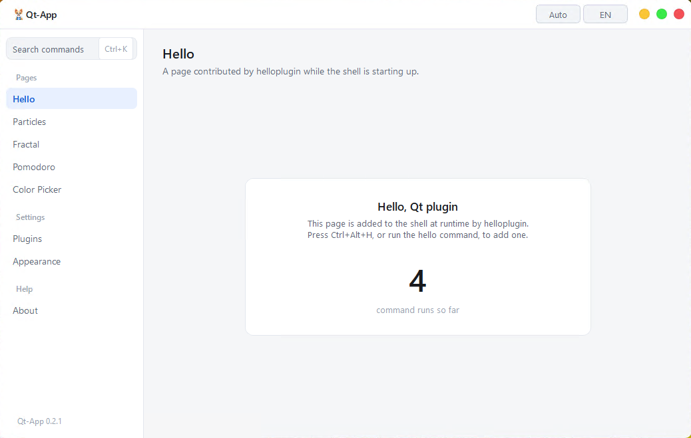

# Qt-App

[English](README.en.md)　英文版由 [readme.yml](.github/workflows/readme.yml) 自动翻译。

> 图片素材来自互联网，仅用于学习演示；商用请自行确认素材授权。代码遵循 [GPL-3.0](LICENSE)。

一个**可以照抄的 Qt 桌面应用模板**：功能只是演示，真正想讲清的是三件事——插件怎么加载、两条构建链怎么保持同构、从编译到安装包怎么走完。

| 想看什么   | 从哪进                                                                                           |
| ---------- | ------------------------------------------------------------------------------------------------ |
| 插件机制   | [src/extensionsystem/](src/extensionsystem)（运行时） + [src/shell/](src/shell)（扩展点）        |
| 两条构建链 | [CMakeLists.txt](CMakeLists.txt) / [cmake/](cmake) 与 [Qt-App.pro](Qt-App.pro) / [qmake/](qmake) |
| 打包与发布 | [packaging/](packaging) + [.github/workflows/](.github/workflows)                                |

## 预览



## 目录结构

| 路径                                        | 内容                                                                                                                                                                                                                                     |
| ------------------------------------------- | ---------------------------------------------------------------------------------------------------------------------------------------------------------------------------------------------------------------------------------------- |
| [src/extensionsystem/](src/extensionsystem) | 插件运行时：[iplugin.hpp](src/extensionsystem/iplugin.hpp)、[pluginmanager.hpp](src/extensionsystem/pluginmanager.hpp)、[pluginspec.hpp](src/extensionsystem/pluginspec.hpp)、[plugincontext.hpp](src/extensionsystem/plugincontext.hpp) |
| [src/shell/](src/shell)                     | 外壳扩展点：[page.hpp](src/shell/page.hpp)、[command.hpp](src/shell/command.hpp)、[host.hpp](src/shell/host.hpp)、[registry.hpp](src/shell/registry.hpp)                                                                                 |
| [src/plugins/](src/plugins)                 | 内置插件，[helloplugin](src/plugins/helloplugin) 是最小模板                                                                                                                                                                              |
| [src/apps/app/](src/apps/app/main.cc)       | `main()`：单实例、日志、主题、Crashpad 初始化、崩溃提示、插件加载                                                                                                                                                                        |
| [src/utils/](src/utils)                     | 主题、设置、异步日志、`FilePath`、`Result` 等基础设施；要碰控件的辅助函数在 [uihelpers.hpp](src/utils/uihelpers.hpp)                                                                                                                     |
| [src/widgets/](src/widgets)                 | 通用控件与对话框                                                                                                                                                                                                                         |
| [src/resource/](src/resource)               | qrc、[QSS 与主题令牌](src/resource/qss)、图标                                                                                                                                                                                            |
| [src/crashpadclient/](src/crashpadclient)   | Crashpad 客户端封装                                                                                                                                                                                                                      |
| [src/3rdparty/](src/3rdparty)               | QtSingleApplication                                                                                                                                                                                                                      |
| [cmake/](cmake) · [qmake/](qmake)           | 两条构建链的模块，一一对应                                                                                                                                                                                                               |
| [packaging/](packaging)                     | 三平台打包脚本、版本号、发布上传                                                                                                                                                                                                         |
| [tests/](tests)                             | QTest 单元测试（只走 CMake，默认不构建）                                                                                                                                                                                                 |
| [translations/](translations)               | `.ts` 翻译源文件                                                                                                                                                                                                                         |
| [docs/](docs)                               | [主题](docs/theming.md)、[编码规范](docs/coding-standards.md)                                                                                                                                                                            |

## 插件机制

插件系统改自 [Qt Creator](https://github.com/qt-creator/qt-creator/tree/master/src/libs/extensionsystem)，保留了"元数据 + 依赖 + 生命周期"三件套，去掉了与 IDE 强绑定的部分。

```text
plugins/<模块名>.dll|so|dylib
  └─ 读 Q_PLUGIN_METADATA 里内嵌的 <id>.json
       └─ 解析 Dependencies（Required / Optional）并按依赖排序
            └─ load → initialize(context)      拿本插件专属 QSettings 与资源根
                 └─ extensionsInitialized()    注册页面/命令；此时其它插件的服务已就绪
                      └─ aboutToShutdown()     与初始化相反的顺序
```

| 扩展点          | 定义                                                       | 用途                                               |
| --------------- | ---------------------------------------------------------- | -------------------------------------------------- |
| `IPlugin`       | [iplugin.hpp](src/extensionsystem/iplugin.hpp)             | 插件入口，`IID` 固定为 `Youth.Qt.plugin`           |
| `PluginContext` | [plugincontext.hpp](src/extensionsystem/plugincontext.hpp) | `initialize()` 里拿 `settings()`、`resourcePath()` |
| `IPage`         | [page.hpp](src/shell/page.hpp)                             | 侧边栏页面（Pages / Games / Settings / Help）      |
| `ICommand`      | [command.hpp](src/shell/command.hpp)                       | 命令面板（`Ctrl+K`）中的动作                       |
| `Host`          | [host.hpp](src/shell/host.hpp)                             | 主窗口、切页、状态栏提示、重启                     |
| 服务对象池      | [pluginmanager.hpp](src/extensionsystem/pluginmanager.hpp) | `addObject()` / `object<T>()`，插件间按接口取服务  |

内置插件各演示一种写法：

| 插件                                               | 演示内容                                                    |
| -------------------------------------------------- | ----------------------------------------------------------- |
| [coreplugin](src/plugins/coreplugin)               | 外壳实现：主窗口、命令面板、插件列表（`Required: true`）    |
| [helloplugin](src/plugins/helloplugin)             | 最小模板：元数据 + 一个页面 + 一条命令 + 持久化设置         |
| [particlesplugin](src/plugins/particlesplugin)     | 自绘控件 + 定时器驱动的帧动画                               |
| [danmakuplugin](src/plugins/danmakuplugin)         | 服务提供者：注册 [`IDanmaku`](src/api/danmaku/idanmaku.hpp) |
| [pomodoroplugin](src/plugins/pomodoroplugin)       | 服务消费者：可选依赖缺失时降级为状态栏提示                  |
| [fractalplugin](src/plugins/fractalplugin)         | 后台计算 + 取消                                             |
| [colorpickerplugin](src/plugins/colorpickerplugin) | 独立工具窗 + 屏幕取色                                       |
| [snakeplugin](src/plugins/snakeplugin)             | 小游戏：固定步进循环、键盘焦点、最高分存档                  |
| [tetrisplugin](src/plugins/tetrisplugin)           | 小游戏：60 Hz 帧循环、SRS 踢墙、DAS/ARR 连发                |

### 新增一个插件

1. 复制 [src/plugins/helloplugin/](src/plugins/helloplugin) 并改名为新插件目录；
2. 改元数据 `<id>.json`：`Id` 必须等于目录名与目标名，`Version` 与 [packaging/version.txt](packaging/version.txt) 一致；
3. 头文件里写 `Q_PLUGIN_METADATA(IID "Youth.Qt.plugin" FILE "<id>.json")`，实现 `IPlugin`；
4. 同时登记到 [src/plugins/CMakeLists.txt](src/plugins/CMakeLists.txt) 与 [src/plugins/plugins.pro](src/plugins/plugins.pro)；
5. `initialize()` 只建对象，`extensionsInitialized()` 里用 `Shell::Registry::instance()` 注册页面与命令。

CMake 侧由 [add_app_plugin()](cmake/PlatformLibraries.cmake) 统一处理插件后缀、输出目录和 RPATH，并校验 json 里的 `Id` / `Version`。

## 构建

| 依赖   | 要求                                                                                                                     |
| ------ | ------------------------------------------------------------------------------------------------------------------------ |
| Qt     | 6.12（默认查找各平台的 6.12.0 路径），可用 `-DQT_ROOT=<dir>` 或环境变量 `QT_ROOT` 覆盖                                   |
| 编译器 | C++23：MSVC 19.34+ / GCC 12+ / Clang 15+                                                                                 |
| CMake  | ≥ 3.25.1，搭配 Ninja                                                                                                     |
| vcpkg  | 默认 `C:/vcpkg` 或 `/usr/local/share/vcpkg`，可用 `-DVCPKG_DEFAULT_ROOT` 改；依赖见 [vcpkg.json](vcpkg.json)（crashpad） |

### CMake（主链，打包与 CI 都用它）

```bash
cmake -S . -B build -G Ninja -DCMAKE_BUILD_TYPE=RelWithDebInfo -DQT_ROOT=/opt/Qt/6.12.0/gcc_64
cmake --build build
cmake --install build --prefix dist   # 可选：安装到前缀目录（Windows/macOS 顺带部署 Qt 依赖）
```

Windows 本机可直接用 [scripts/windows/dev.ps1](scripts/windows/dev.ps1)（[说明](scripts/windows/README.md)），它会先进 MSVC 开发环境：

```powershell
.\scripts\windows\dev.ps1 -Action configure
.\scripts\windows\dev.ps1                                   # 编译
.\scripts\windows\dev.ps1 -Action run -AppArgs '--console','--log-level=debug'
```

产物在 `binaries/cmake/<arch>/bin/<config>/`（主程序 + `plugins/qt-app/` + `resources/` + `translations/`），布局见 [OutputDirectories.cmake](cmake/OutputDirectories.cmake)。

### 单元测试

QTest + CTest，默认不构建；产物在 `binaries/cmake/<arch>/tests/<config>/`，不参与安装与打包。

```powershell
.\scripts\windows\dev.ps1 -Action test
```

其他平台：configure 时加 `-DBUILD_TESTS=ON`，再 `ctest --test-dir build --output-on-failure`。测试目录结构见 [tests/](tests)。

### qmake（备用链，只做编译验证）

```bash
mkdir build && cd build
qmake ../. && make -j
```

产物在 `binaries/qmake/<arch>/bin/{debug,release}/`；依赖按经典模式装在 vcpkg 根目录下，见 [qmake/VcpkgToolchain.pri](qmake/VcpkgToolchain.pri)。打包不使用这条链。

### 常用 CMake 选项

| 选项                           | 默认         | 说明                                    |
| ------------------------------ | ------------ | --------------------------------------- |
| `-DQT_ROOT=<dir>`              | 平台默认路径 | Qt 前缀                                 |
| `-DVCPKG_TARGET_TRIPLET=<t>`   | 按平台       | 与 qmake 侧保持一致                     |
| `-DUSE_VCPKG=OFF`              | `ON`         | 关闭后需自行提供 `crashpad` 的 CMake 包 |
| `-DUSE_UNITY_BUILD=ON`         | `OFF`        | unity/jumbo 构建                        |
| `-DRELEASE_WITH_DEBUGINFO=OFF` | `ON`         | Release 是否带调试信息                  |
| `-DBUILD_TESTS=ON`             | `OFF`        | 构建 QTest 单元测试（不安装、不打包）   |

## 打包与发布

版本号只有一个来源：[packaging/version.txt](packaging/version.txt)。CMake、qmake 与所有打包脚本都读它，`vcpkg.json` 中的 `version` 不一致会在配置时告警。

| 平台                 | 产物                                                | 入口                                                                                                                                                        |
| -------------------- | --------------------------------------------------- | ----------------------------------------------------------------------------------------------------------------------------------------------------------- |
| Windows              | `*.7z` 便携包 + Inno Setup 安装程序                 | [packaging/windows/package.ps1](packaging/windows/package.ps1)、[app.iss](packaging/windows/app.iss)                                                        |
| macOS                | x86_64 / arm64 / universal 的 `.dmg`、`.pkg`、`.7z` | [packaging/macos/package.sh](packaging/macos/package.sh)，通用二进制由 [merge_universal_app.sh](packaging/macos/app_arch_tools/merge_universal_app.sh) 合并 |
| Ubuntu               | `.AppImage`、`.deb`、`.7z`                          | [packaging/ubuntu/package.sh](packaging/ubuntu/package.sh)                                                                                                  |
| Ubuntu/Debian 官方包 | debhelper 流程产出的 `.deb`                         | [packaging/debian/rules](packaging/debian/rules) + [debian.yml](.github/workflows/debian.yml)                                                               |
| 自建更新源           | 各平台产物 + `update.json`                          | [packaging/upload.py](packaging/upload.py)                                                                                                                  |

三个平台的脚本都把产物写进 `packaging/releases/`，由 [flatten_releases.sh](packaging/flatten_releases.sh) 平铺后发布。CI 分工：

| 工作流                                           | 作用                                        |
| ------------------------------------------------ | ------------------------------------------- |
| [cmake.yml](.github/workflows/cmake.yml)         | 三平台构建打包，打 tag 时自动发布 Release   |
| [test.yml](.github/workflows/test.yml)           | 三平台跑 QTest 单元测试（不打包）           |
| [qmake.yml](.github/workflows/qmake.yml)         | qmake 链的编译验证                          |
| [debian.yml](.github/workflows/debian.yml)       | Debian 官方包                               |
| [toolchain.yml](.github/workflows/toolchain.yml) | 预构建依赖缓存                              |
| [readme.yml](.github/workflows/readme.yml)       | 把本文件翻译成 [README.en.md](README.en.md) |

## 主题与国际化

- **主题**：一组 QSS + 两个 `.theme` 令牌文件，切换深浅色时重新生成样式表并同步调色板，见 [docs/theming.md](docs/theming.md)。
- **国际化**：翻译文件在 [translations/](translations)，`cmake --build build --target Qt-App_lupdate` 更新、`Qt-App_lrelease` 发布；当前切换语言后需重启生效，实时刷新写法见 `changeEvent(QEvent::LanguageChange)` + `retranslateUi()`。

## 崩溃报告

Crashpad 以「进程内客户端 + 独立 handler」的方式接入，见 [src/crashpadclient/](src/crashpadclient)：崩溃时 handler 把 dmp 写进
`<AppConfigLocation>/crash`，`reportUrl` 传空即只落盘、不上传。

进程崩溃时自己已经退出了，所以提示只能由**下一次启动**发出：`main()` 在插件加载之前查一次 crashpad 数据库里的待处理报告，
有就弹出 [crashdialog](src/apps/app/crashdialog.cc)。用户关闭后报告被标记为 completed，不会反复提示；选「重启」则复用主程序
已有的 restart 机制，而不是再起一个进程。

已知边界：`StartHandler` 之前（极早期）的崩溃不会产生 dump，因此也不会有提示。

## 常见问题

- **插件没被加载**：先看 `*.json` 的 `Id` 是否等于库文件名，`Version` 是否与 [version.txt](packaging/version.txt) 一致；插件目录应位于可执行文件旁的 `plugins/qt-app/`。
- **Windows 打包**：需要 `7z` 在 `PATH`、已安装 Inno Setup，并通过 [Enter-VsDevShell.ps1](packaging/windows/Enter-VsDevShell.ps1) 进入 MSVC 环境。
- **macOS 未签名**：安装包默认不做签名/公证，本地运行需 ad-hoc 签名：`codesign --force --deep --sign - Qt-App.app`。
- **Ubuntu 运行**：需要 `libfuse2`、`libxcb-cursor0`；Wayland 下窗口行为异常时可设 `QT_QPA_PLATFORM=xcb`。
- **崩溃后没看到提示**：`crashpad_handler` 必须有执行权限（`chmod +x`）；提示在崩溃之后的**下一次启动**才出现，
  没有新 dmp 时不会弹窗。
- **卸载后残留用户数据**：Windows 安装包与 Linux 的 `.deb` 会在卸载时删掉配置/日志/崩溃/缓存；
  macOS 的 `.pkg` 没有卸载钩子（拖走 `.app` 即可），需要手动清理
  `~/Library/Preferences/Youth/Qt-App`、`~/Library/Caches/Youth/Qt-App`。
  用户数据的具体落点见 [src/utils/appinfo.hpp](src/utils/appinfo.hpp) 的注释。

## 文档

- [docs/coding-standards.md](docs/coding-standards.md)：命名、PIMPL、信号槽与提交前检查
- [docs/theming.md](docs/theming.md)：令牌替换与移植到其它 Qt 程序
- [scripts/windows/README.md](scripts/windows/README.md)：本机开发脚本与 `.ps1` 编码约定
